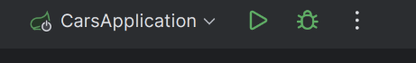
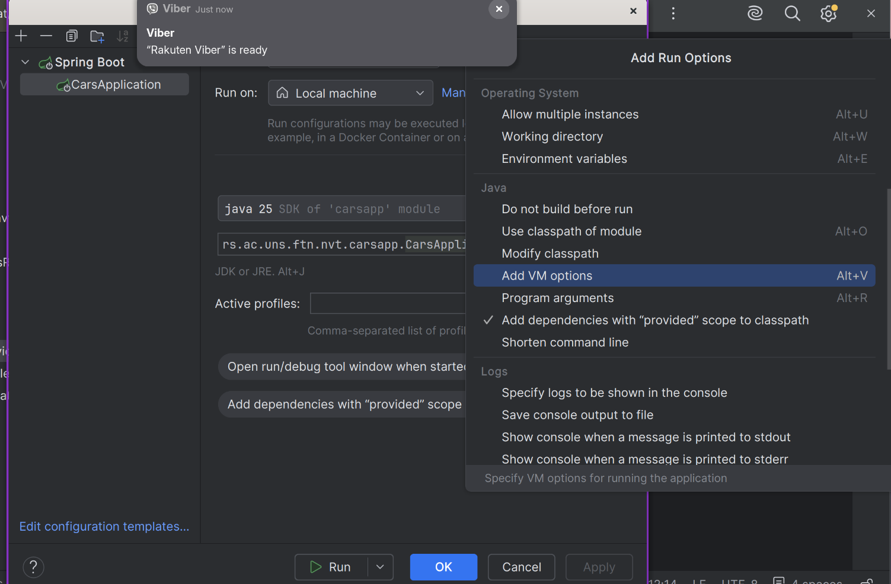
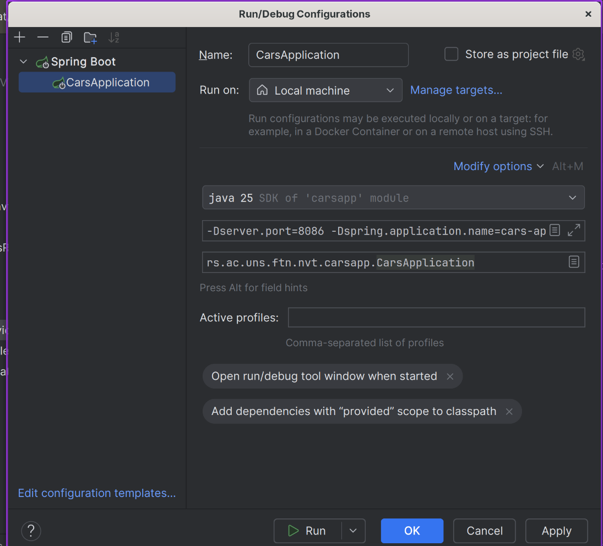

# Reverse proxy

Web aplikaciju mozete postaviti na neki server, te korisnici komuniciraju sa njom, direktno bez posrednika. Za male aplikacije i mali broj korisnika ovo je dovoljno dobro. Problemi se javljaju kada je neophodno podrzati veci broj korisnika, koordinirati interakciju vise servisa.

U opstem slucaju, klijentski kod (pa i sam korisnik) ne treba da zna tacno sa kojim serverom komunicira. Klijent treba da poznaje jednu adresu (simbolicku ili IP) koju gadja kako bi se ostvarila komunikacija. Pored apstrakcije interakcija korsinika sa celom infrastrutkurom, potencijalno se javlja potreba da kompletna infrastruktura usluga, kako web aplikacija tako i baze podataka, redova proluka, biva sakrivena od spoljnih korisnika. Ovo za cilj ima da omoguci izolaciju dodatnih servisa od korisnika, kako ne bi postajala mogucnost da se ostvari komunikacija sa privatnom infrastrukturom.

Pored uproscavanja interakcije korisnika sa servisima aplikacije, neophodno je sprovesti i balansiranje opterecenja. Balansiranje opterecenja podrazumeva automatsko rutiranje saobracaja koji je namenjen jednom servisu na vise istih servisa. Ovime se postize da jedan singularan servis ne biva opterecen (odnosno bombardovan) zahtevima, te se celokupni saobracaj raspodeli na vise instanci. 

## Nginx

Jedna od reverse proxy tehnologija. Poseduje svoju sintaksu koju treba ispostovati, koja definise pravila i logiku rutiranja zahteva. Ova pravila se mogu definisati u okviru jednog konfiguracionog file-a, te se on moze proslediti nginx-u prilikom njegovog pokretanja.

Nginx je ustanju da sprovede efektivno rutiranje zahteva da definisanih servisa, kao i da podrzi mehanizam balansiranja opterecenja. Pored toga, kako bi svi korisnici imali jednako iskustvo prilikom koriscenja korisnickog interfejsa ili prikaza statickih resursa, putem nginx mozete servirati korisnicki interfejs aplikacije (izgradjeni interfejs u obliku html/js/css).

## Instalacija

Da biste instalirali Nginx lokalno neophodno je da ga preuzmete putem orignalnog veb sajta:

```text
https://nginx.org/en/download.html
```

ili ako ste na Linuxu pozovete vas _package manager_, odnosno ako koristite _dnf_.

```bash
sudo dnf install nginx
```

Ili ako koristite _apt_

```bash
sudo apt install nginx
```

Nakon sto zavrsi neophodno je da pokrene Nginx kao servis. Na Linux-u se navedeno obavlja kao:

```
sudo systemctl start nginx 
```

Nakon ovoga nginx bi treba da bude spreman za pokretanje.

## Upravljanje konfiguracijom

Podrazumevano ponasanje Nginx-a je da preuzme `.conf` datoteku iz predefinanog direktorijuma, odnosno mesta gde je on instaliran. U slucaju sa Linux-om, to je najcesce `/etc/nginx/nginx.conf`. Ovo bi podrazumevalo da vasu konfiguraciju prenesete u ovaj folder, te kada pokrenete nginx on nju pokupi i ucita, odnosno pokrente komandu:

```bash
sudo nginx
```

Radi lakseg koriscenja, mozete proslediti apsolutnu putanju putem `-c` flag-a, odnosno:

```bash
sudo nginx -c "/apsolutna_putanja_do_konfiguracije"
```

Ili jos lakse ako ste terminal otvorili u istom direktorijumu gde je konfiguracija:

```bash
sudo nginx -p "$(pwd)" -c ime_moje_konfiguracije.conf
```

Da biste nginx zaustavili, ponovo pokrenuli, ugasili ili testirali konfiguraciju, koristite sledece komande:

```bash
sudo nginx -s reload       # ponovo učitava konfiguraciju
sudo nginx -s stop         # brzo zaustavljanje
sudo nginx -s quit         # graceful zaustavljanje
sudo nginx -t              # provera sintakse konfiguracije
```

Da biste pokrenuli drugu konfiguraciju, **neophodno je da provobitno zaustavite Nginx**. U suprotnom cete dobiti poruku o gresci da je port vec zauzet.

## Primer

### Setup

U primeru ovih vezbi, dostavljena vam je konfiguracija Nginx-a, dve aplikacije o vozilima i proizvodima, docker-compose, inicijalizaciona skripta za baze podataka, kao i interfejs sadrzan u `view/index.html`.

Prvo pokrenite docker-compose.yml, putem komande:

```bash
docker compose up
```

Ako ne zelite da vam bude blokiran terminal:

```bash
docker compose up -d
```

Pokrenite Nginx sa prosledjenom konfiguracijom, i navigirajte se u pretrazivacu na `http://localhost:8787`. Ovde ce vam biti serviran `index.html`.

Neophodno je da pokrenete serverske aplikacije. Aplikaciju u vozilima treba da pokrenete dva puta sa razlicitim portovima i imenima. Ovo mozete sprovesti u razvojnom okruzenju `Intelij IDEA` tako sto specificirate parametre unutar konfiguracije u gornjem desnom uglu, pored dugmadi za porketanje, debug i zaustavljanje. Neophodno je otvorite prozor za izmenu konfiguracije, odnosno `klik na tri tackice -> Edit...`



Kada vam se otvori prozor da izmeniti konfiguraciju, u sekciji `VM Options` (ako je nema kliknite na segment `Modify options` te onda selektujte `Add VM Options`).




Da biste unutar `VM Options` sepcificirali unutar vase konfiguracije, odnostno port i ime aplikacije, mozete to uraditi na sledeci nacin:

```text
-Dserver.port=8086 -Dspring.application.name=cars-api-primary
```

Ovo treba da izlgeda ovako:



Napravite drugu konfiguraciju i zadajte joj ime. U ovoj konfiguraciji unutar sekcije `VM Options` cete ponovo zadati port i ime na sledeci nacin:

```text
-Dserver.port=8087 -Dspring.application.name=cars-api-secondary
```

### Demonstracija

Samu konfiguraciju Nginx, sadrzanu u nginx.conf, mozete analizirati. Pojedini segmenti su pokriveni komentarima kao objasnjenje sintakse i funkcionalnosti. Glavne funkcionalnosti su demostrirane kroz korisnicki interfejs, odnosno datoteku `index.html` unutar `view` foldera.

Klikom na dugme `Show products` prikazani ce biti svi proizvodi sadrzani u bazi podataka. Ovo ima za cilj da demonstrira rutiranje zahteva na `productsapp`, iako sama klijentska aplikacija gadja jednu adresu, odnoso:

```javascript
const response = fetch('/carsapi/cars').then(response => {
   // super zanimljiva logika parsiranja u redove tabele :)
});
```

Klikom na dugme `Show cars` prikazani ce biti svi automobili sadrzani u bazi podataka, sa dodatnom kolonom koja ce ispisati i ime servera koji je opsluzio zahtev. Pored demonstracije korektnog rutiranja na `carsapp` instancu, ovaj primer demonstrira i balansiranje opterecenja, time sto uporednim klikovima na dugme `Show cars` u tabeli ce vam biti prikazano razlicito ime servera koji je opsluzio zhatev.

```javascript
const response = fetch('/carsapi/cars').then(response => {
   // super zanimljiva logika parsiranja u redove tabele :)
});
```