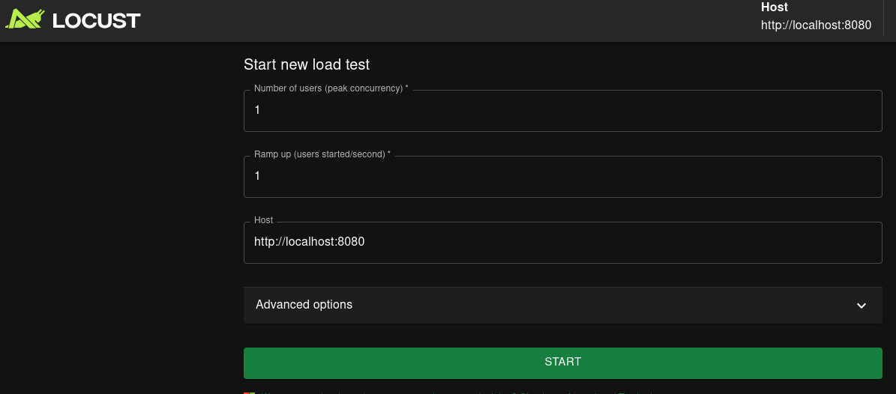
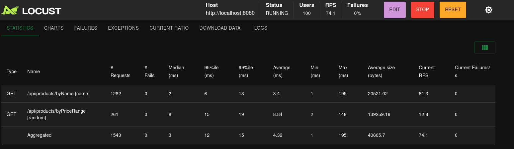
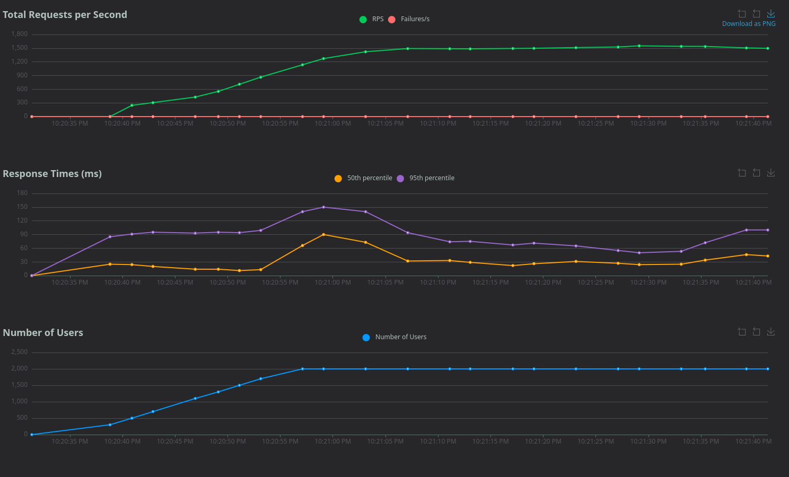

# Testiranje opterecenja

Veb aplikacije u najuzem smislu opsluzuju zahteve korisnika za odredjeni slucaj poslovnog domena. Postavlja se pitanje do koje mere aplikacija moze da funkcionise normalno. Da li se sa povecanjem broja korisnika povecava latencija, broj neuspelih zahteva, pa cak i kompletan otkaza aplikacije. Testiranje opterecenja ima za cilj da testira mogucnost aplikacije, u pogledu koju kolicinu korisnika moze da opsluzi, a pri tome da se njene performanse ne degrediraju.

Pored toga, testiranje opterecenja ima za cilj da postavi produkcione parametre aplikacije. Broj konekcija ka bazi podataka, broj niti kojima aplikacija upravlja, implementacija i flow logike slucajeva koriscenja su jedni od aspekata koje je neophodno odrediti ili optimizovati, koje testiranje opterecenja pokusava da adresira.

Postoji mnogo alata za sprovodjenje testiranja opterecenja, ali u najuzem smislu svaki od njih sprovodi "bombardovanje" aplikacije zahtevima radi pronalazenja tehnoloskog duga i generalnih problema sa kojim se aplikacije susrecu.

## Locust

_Locust_ je moderan, _open-source_ alat za testiranje opterecenja napisan u programskom jeziku _Python_. Za razliku od mnogih starijih alata koji koriste teske niti (threads) ili procese za simulaciju korisnika, Locust se oslanja na asinhroni model (koristeci _Python_ biblioteku _gevent_). Ovo omogucava da sa jednom masinom pokrenete stotine hiljada virtuelnih korisnika istovremeno.

Scenariji opterecenja se definisu kroz obicne _Python_ skripte. Nema potrebe za ucenjem slozenih _XML_, _JSON_ ili _DSL_ formata - koristite standardne petlje, uslove i funkcije. Locust dolazi sa ugradjenim veb interfejsom. Kada pokrenete test, otvarate browser i u realnom vremenu pratite grafike: broj trenutnih korisnika, ukupan broj zahteva u sekundi (_RPS_), latenciju (_Response Time_) i procenat gresaka u zahtevima.

## Primer

### Setup

Da biste pokrenuli primer neophodno je da imate instaliran _Python_ programski jezik (konkretno verziju 3.14), _Docker_, _Java_ programski jezik.

- [Docker i docker compose instalacija](https://docs.docker.com/engine/install/)
- [Nodejs i NPM instalacija](https://nodejs.org/en/download)
- [Angular instalacija](https://angular.dev/installation)


Prvo je neophodno da kreirate _Python_ virtuelno orkuzenje, koristeci komandu:

```bash
python -m venv .venv
```

Nakon cega cete ga aktivirati u terminalu:

```bash
# Linux
source .venv/bin/activate
```

```bash
# Windows
.venv\Scripts\activate.bat
```

**Napomena**: ukoliko vam _Windows-ov_ _Powershell_ ne dozvoljava da pokrenete skripte, u terminalu koji ima administratorske privilegije pokrenite sledecu komandu:
```ps1
Set-ExecutionPolicy -ExecutionPolicy RemoteSigned -Scope Process
```

Nakon toga neophodno je da instalirate potrebne pakete, koji su sadrzani unutar `requirements.txt` datoteke. Ovo mozete uraditi komandom:

```bash
pip install -r requirements.txt
```

Nakon toga mozete pokrenuti alat _Locust_, putem komande:
```bash
locust -f ime_mog_locust_fajla.py
```

Nakon sto je locust pokrenut, u okviru terminala bice vam data adresa veb interfejsa alata kojoj mozete pristupiti (najcesce `http://0.0.0.0:8089`)

Unutar `docker-compose.yml` je definisan `postresql` servis sa bazom podataka namenjenom za serversku aplikaciju, te pokrenite komandu:
```bash
docker compose up
```
Odnosno ako ne zelite da vam bude blokiran ternimal:
```bash
docker compose up -d
```
Ovo ce podici potrebnu `postresql` bazu za ovaj primer.


Dodatno je neophodno da pokrenete serversku aplikaciju koja je napisana u `Java` programskom jeziku. Ovo mozete uraditi putem vaseg razvojnog okruzenja, pri cemu ce biti pokrenuta _Spring Boot_ veb aplikacija **koja slusa na portu 8080**.

### Demonstracija

`locustfile.py` je _Python_ fajl koji opisuje slucajeve koriscenja za koje testiramo okruzenje. Navedeni fajl mozete analizirati i sa njime eksperimentisati po potrebi. Najbitnije je spomenuti da _Locust_ unutar jednog svog fajla trazi metode koje su oznacene anotacijom `@task`. Prilikom otpocinjanja testiranja opterecenja, logika unutar metoda oznacenih ovom anotacijom ce se pokrenuti, odnosno logika koja predstavlja (najcesce) jedan _HTTP_ zahtev ka odredjenom servisu. 

Locust ce pokrenuti svaku metodu koja je oznacena anotacijom `@task`. Ovo znaci da ukoliko testirate iskljucivo jedan _endpoint_ aplikacije, bitno je da u fajlu postoji samo jedna metoda oznacena sa `@task`.


Kada otvorite veb interfejs _Locust_ alata, dobicete sledeci ekran.



Najbitniji parametri na ekranu su prikazana input polja.

Polje `"Number of users"` definise konacan broj korisnika za _load test_. _Locust_ ce krenuti od 0 korisnika, nakon cega ce taj broj povecavati. _Locust_ prestaje da povecava broj korisnika kada dostigne broj korisnika koji ste zadali ovim polje. Drugim recima, kada kazemo "Ovaj test je radjen sa 2000 istovremenih korisnika" (parafrazirano), misli se da je broj, u ovom slucaju 2000, zadat unutar ovog polja kao "plafon" mogucih korisnika.

Polje `"Ramp up"` definise broj korisnika koji predstavlja korak povecanja za _load test_. U svakoj sekundi, _Locust_ ce povecati broj korisnika za korak koji ste ovde zadali. _Locust_ prestaje povecavanje broja korisnika kada dodje do broja koji ste zadali u prethodnom polju. U prakticnom smislu ovo treba da simulira postepeno povecavanje korisnika, kao i da lakse mozete ispratiti kada latencija postaje veca ili kada se javljaju otkazi tokom _load test-a_.

Polje `"Host"` definise adresu veb aplikacije/servisa nad kojim sprovodite _load test_.

Nakon sto zadate ove parametre mozete pokrenuti _load test_ putem dugmeta `"Start"`.

Kada pokrente _load test_, dobicete sledeci ekran gde vam je prikazana trenuta statistika, sadrzana u `"Statistics"` tabu interfejsa. Pored toga, u bilo kom momentu u gornjem desnom uglu imate uproscenu statistiku, kao i kontrole za upravljanje _load test-om_. 



Daleko vise informativnu statistiku i prikaz izvrsavanja _load test-a_ imate pod tabom `"Charts"`. Ovde mozete videti kako se latencija, broj zahteva u minuti, otkazi i broj korisnika krecu u jedinici vremena. Grafici vam omogucavaju da pravite predpostavke o problemima i anomalijama sa kojima se susrecete dok aplikacija radi (npr. "Da li na "01:04" sam uspeo da izgubim sve konkecije ka bazi, pa zbog toga imam vecu stopu otkaza?").



_Load test_ mozete zaustaviti putem kontrole `"Stop"` u gornjem desnom uglu veb interfejsa, ili mozete prekinuti _Locust_ proces u terminalu.